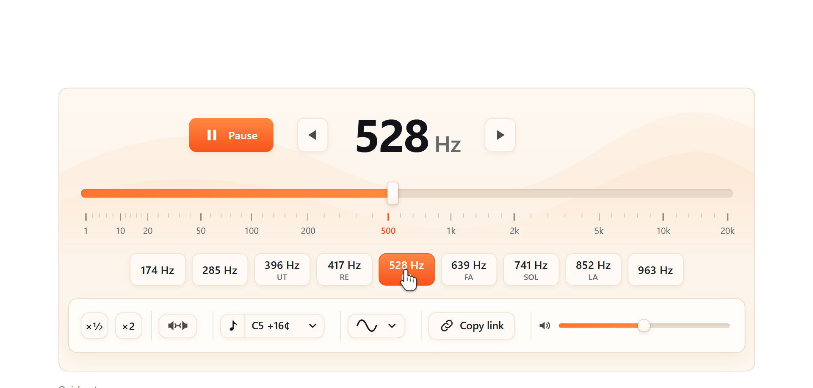

# Solfeggio Frequencies Generator: 174 to 963 Hz, pure tones online

**[Play the solfeggio frequencies online](https://toolster.net/tone_generator/solfeggio-frequencies)**. Free, nothing to install, one tap per tone and no music on top.



All nine solfeggio tones as a clean, steady sine wave: 174, 285, 396, 417, 528, 639, 741, 852 and 963 Hz.

## Features

- Nine solfeggio tones from 174 to 963 Hz, one button each
- Pure sine tone, no background music or rain mixed in
- Instant switching between tones to compare them back to back
- Volume and left or right balance
- Any other frequency by typing it in or moving the slider

## The nine tones

| Frequency | Syllable | Nearest note |
|---|---|---|
| 174 Hz | | F3 -6 cents |
| 285 Hz | | C#4 +48 cents |
| 396 Hz | UT | G4 +18 cents |
| 417 Hz | RE | G#4 +7 cents |
| 528 Hz | MI | C5 +16 cents |
| 639 Hz | FA | D#5 +46 cents |
| 741 Hz | SOL | F#5 +2 cents |
| 852 Hz | LA | G#5 +44 cents |
| 963 Hz | | B5 -44 cents |

The full table with digit roots, periods and wavelengths is in [`solfeggio-frequencies.csv`](solfeggio-frequencies.csv).

## How to use it

1. Open **[the generator](https://toolster.net/tone_generator/solfeggio-frequencies)** and tap one of the nine buttons. The tone starts at once.
2. Set a comfortable volume. A quiet tone is enough for meditation; in headphones start low.
3. Press Pause or Space when you are done.

## Helper scripts

Small Node.js scripts, no dependencies (Node 18+):

```bash
npm run table                    # the nine tones with nearest note and cents
node scripts/interval.js 396 528 # ratio, cents and musical interval between two tones
npm run csv                      # rebuild solfeggio-frequencies.csv
npm test
```

## More

- [About the solfeggio frequencies](ABOUT.md): where they come from, what they are used for, what science says
- Other languages: [Частоты сольфеджио (RU)](https://ru.toolster.net/tone_generator/solfeggio-frequencies), [Frecuencias solfeggio (ES)](https://es.toolster.net/tone_generator/solfeggio-frequencies)
- 240+ free browser tools: [toolster.net](https://toolster.net)

Found a bug or want a feature? [Open an issue](../../issues).

The generator itself is a hosted web app, its source code is not published here. The helper scripts are MIT licensed, the table and texts are free to reuse with a link back.
